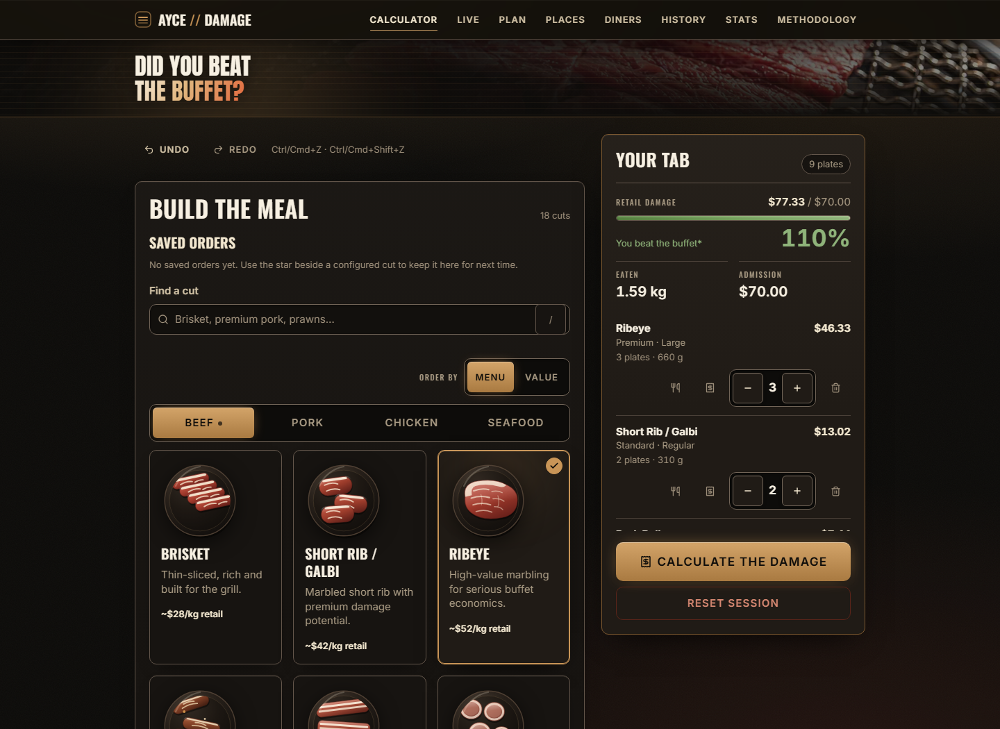
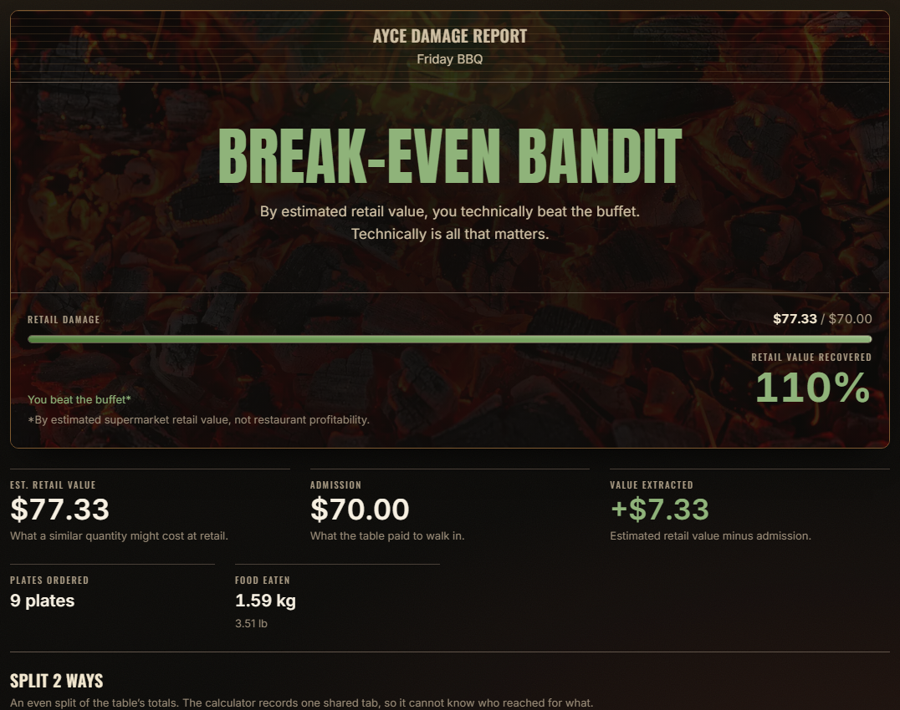
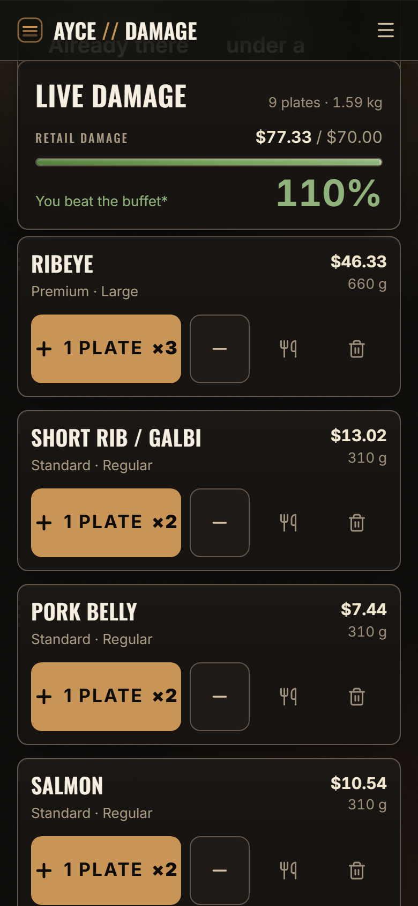
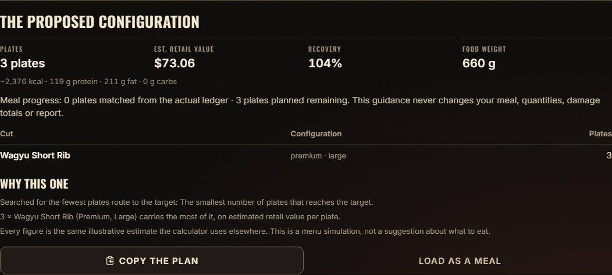

# AYCE Damage Calculator

[](https://github.com/lorenzodarioben-lgtm/ayce-damage-calculator/actions/workflows/ci.yml)

**Did you beat the buffet, or fund their next renovation?**

A Korean BBQ meal tracker with a running tab and an unnecessarily dramatic verdict. Pick your cuts,
log your plates, and see how their estimated retail value stacks up against what you paid.

**[Try it in your browser](https://ayce-damage-calculator.vercel.app)**



## From first plate to final verdict

- **Build your tab.** Choose from 18 cuts, set the quality and portion size, and add your own menu
  items. Adjust a plate count whenever you need to.
- **Keep up at the table.** Live mode gives you big, one-tap buttons for repeat orders, plus a meal
  clock and running totals.
- **Get the damage report.** See estimated retail value, ingredient cost, nutrition, and a verdict
  ranging from _Corporate Sponsor_ to _Do Not Return_.
- **Bring the whole table.** Attribute plates to diners and account for discounts, fees, extras,
  and food left on a plate.
- **Keep the receipts.** Save meals, compare visits, revisit favourite orders, and share a result
  card or link.
- **Plan the next visit.** Try different cuts and portions against a target before you start eating.

| The final report                                                                                                            | Live mode on a phone                                                                                                                 |
| --------------------------------------------------------------------------------------------------------------------------- | ------------------------------------------------------------------------------------------------------------------------------------ |
|  |  |

The planner lets you try a few different approaches. A simulation stays separate from your logged
meal until you choose to load it.



## What the numbers mean

Retail value estimates what the food would cost at a supermarket. Ingredient cost uses a separate
estimate of what a restaurant might pay. Recovery compares the retail estimate with your buffet bill.

Prices, portions, and nutrition are estimates. The report includes alternative scenarios so you can
see how much the assumptions matter. Ingredient margin excludes operating costs and is not profit.
The verdict is for fun.

## Your meals stay on your device

No account or analytics. Meals and saved settings live in your browser, and the app works offline
after the first visit. Export a backup if you want to keep a copy or move to another browser.

Sharing is optional. A shared link carries the selected data in the URL; shared reports leave out
diner names and private notes.

## Run it locally

Use Node.js 22.13 or newer.

```bash
git clone https://github.com/lorenzodarioben-lgtm/ayce-damage-calculator.git
cd ayce-damage-calculator
npm ci
npm run dev
```

Open the local URL printed in the terminal. Built with Next.js, React, TypeScript, Tailwind CSS,
and IndexedDB.

```bash
npm run verify                  # formatting, lint, types, unit tests, and production build
npx playwright install chromium # first-time browser setup
npm run test:e2e                # desktop and mobile browser tests
```

For more detail: [contributing](CONTRIBUTING.md), [custom menus](CONFIGURABLE_MENUS.md),
[product notes](PRODUCT.md), [design](DESIGN.md), and [security](SECURITY.md).

[MIT license](LICENSE)
